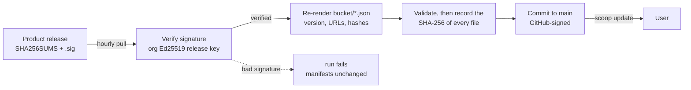

<div align="center">

# Glyndor Scoop bucket

**Scoop manifests for Glyndor's Windows binaries.**
The Windows counterpart to [apt.glyndor.net](https://apt.glyndor.net) (Linux)
and the [Homebrew tap](https://github.com/Glyndor/homebrew-tap) (macOS).

[](https://github.com/Glyndor/scoop-bucket/actions/workflows/tests.yml)
[](https://github.com/Glyndor/scoop-bucket/actions/workflows/update.yml)

</div>

## Install

```powershell
scoop install git
scoop bucket add glyndor https://github.com/Glyndor/scoop-bucket
scoop install podup
```

A bucket is a git clone, so Scoop refuses to add one without git. Skip the
first line if you already have it.

This bucket carries one package, [`podup`](https://github.com/Glyndor/podup):
a Docker-compose translator and runner for rootless Podman.

## Upgrades

```powershell
scoop update
scoop update podup
```

The first line re-syncs the bucket clone. On its own, `scoop update podup`
compares against the copy on disk and reports the version you already have as
the latest one, until Scoop next refreshes the bucket by itself.

## What you are trusting

**The checksum in each manifest does not come from the release asset.** It
comes from a `SHA256SUMS` this repository verified against the organisation's
Ed25519 release key first, the same key the products embed.

The verifier also accepts a second signature beside the Ed25519 one: an
ML-DSA-65 (FIPS 204) signature over the same `SHA256SUMS`. It is a hybrid and
never a replacement, so the Ed25519 signature is checked first and always, and
the second one is checked whenever the release carries it. No product publishes
that second signature yet, so every release today is admitted exactly as it was
before, and the second signature only starts to protect a release once one
carries it.

`scoop` reads this repository straight from GitHub, so there is no separate
server in the path, and a download whose bytes do not match the pinned SHA-256
is refused.



Nothing is pushed here from a product, and no product holds a write
credential on this repository. A product whose signature does not verify is skipped, its manifest stays on its
last verified release and the run fails at the end; the other products still
update. The failure mode is a manifest that stops updating, never one that ships
an unverified binary.

The one credential here, the GitHub App's private key, is read in one job of
the workflow that refreshes the bucket, and that job runs nothing it did not
write itself: it commits only the files whose SHA-256 matches the ones the job
that downloaded and rendered the releases recorded. A download that failed
closed, or a file that changed on the way to the commit, stops the run instead
of being published.

The [threat model](docs/threat-model.md) lists each threat, the control that
answers it, and the evidence for it: a test that fails when the control is
removed, a measurement, or an explicit note that none exists yet.

---

See [CONTRIBUTING.md](CONTRIBUTING.md). Report a problem via the
[Security](https://github.com/Glyndor/scoop-bucket/security) tab.
[MIT](LICENSE).
