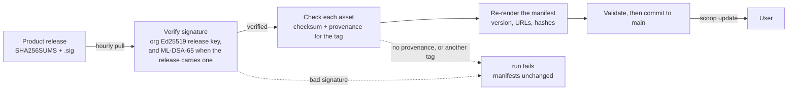

# Glyndor Scoop bucket

Scoop manifests for Glyndor software on Windows, for `x86_64` and `arm64`.

[](https://github.com/Glyndor/scoop-bucket/actions/workflows/tests.yml)
[](https://github.com/Glyndor/scoop-bucket/actions/workflows/update.yml)

## Install

```powershell
scoop install git
scoop bucket add glyndor https://github.com/Glyndor/scoop-bucket
scoop install podup
```

A bucket is a git clone, so Scoop refuses to add one without git. Skip the
first line if you already have it.

podup needs Podman 6.2.0 or newer, reached through a local socket, and does not
support Podman 5. On Windows that means a running `podman machine`; [podup's
Windows notes](https://github.com/Glyndor/podup/blob/main/docs/docker-migration.md#windows)
explain the setup. Then follow podup's [quick start](https://github.com/Glyndor/podup#quick-start).

The Windows binary is not Authenticode-signed, and Smart App Control has been
reported to block it; the same notes say what was reported and describe the WSL
route.

## What is served

| Package | What it is | Platforms |
| --- | --- | --- |
| [`podup`](https://github.com/Glyndor/podup) | Run Compose projects on rootless Podman. | Windows, `x86_64` and `arm64` |

podup is also available from the [Glyndor apt repository](https://github.com/Glyndor/apt)
for Debian and Ubuntu and from the [Homebrew tap](https://github.com/Glyndor/homebrew-tap)
for macOS and Linux.

## Updates

```powershell
scoop update
scoop update podup
```

The first line re-syncs the bucket clone. On its own, `scoop update podup`
compares against the copy on disk and reports the version you already have as
the latest one, until Scoop next refreshes the bucket by itself. The bucket
checks for a new release every hour, which GitHub often runs late, so a release
is usually served within a few hours.

## What you are trusting

The checksum in each manifest does not come from the release asset. It comes
from a `SHA256SUMS` this repository verified against the organisation's Ed25519
release key first, the same key the products embed. Each asset is also
downloaded and its SHA-256 compared with that manifest, and it must carry build
provenance for the release tag from the product's release workflow, so an old
binary re-published under a new tag is refused even when its signature is valid.

`scoop` reads this repository straight from GitHub, so there is no separate
server in the path, and a download whose bytes do not match the pinned SHA-256
is refused. To check a version by hand, compare the `hash` values in
`bucket/podup.json` with the `SHA256SUMS` file attached to the matching podup
release.

A second, post-quantum release signature (ML-DSA-65) is supported beside the
Ed25519 one and never replaces it; no ML-DSA-65 key is configured yet, so every
release is admitted on its Ed25519 signature.



Nothing is pushed here from a product: the bucket pulls. A bad signature fails
the run and leaves the manifests untouched, so the failure mode is a bucket that
stops updating, never one that ships an unverified binary.

The [threat model](docs/threat-model.md) says what this bucket protects, against
whom, and which test holds each control in place.

---

See [CONTRIBUTING.md](CONTRIBUTING.md). Report a problem via the
[Security](https://github.com/Glyndor/scoop-bucket/security) tab.

[MIT](LICENSE).
